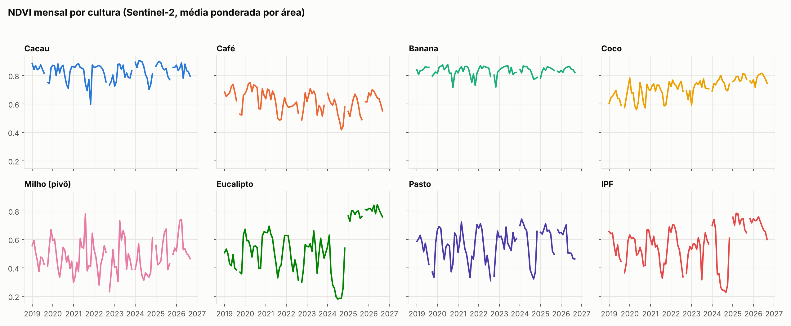
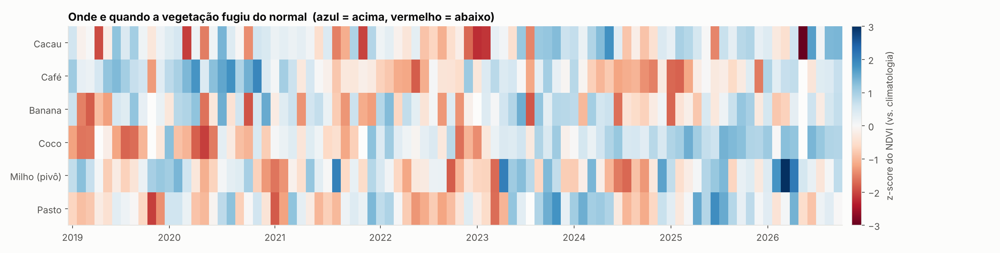
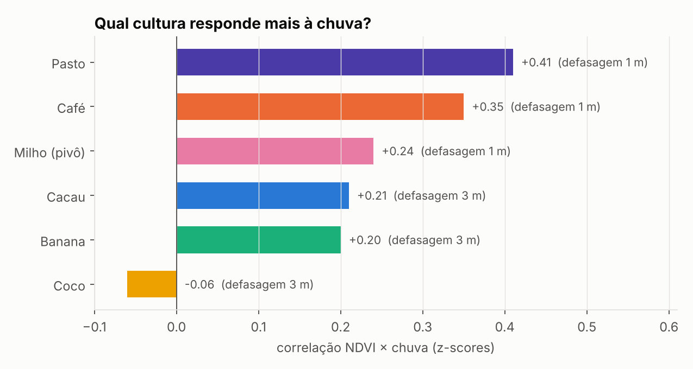
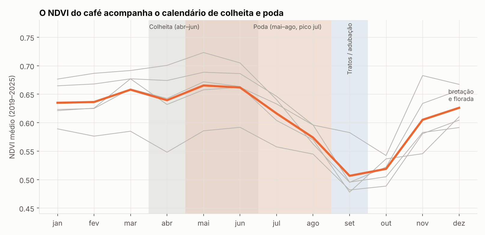

# 🌱 Vigor da vegetação por cultura — Sentinel-2 + Google Earth Engine

Série mensal 2019–2026 de **NDVI, NDRE e NDMI** em 23 talhões de 8 usos do solo
(cacau, café, banana, coco, milho irrigado, eucalipto, pasto e integração pecuária-floresta),
cruzada com chuva (CHIRPS) e temperatura de superfície (MODIS).

**Perguntas respondidas**
1. Qual o perfil sazonal de cada cultura?
2. Quando a vegetação saiu do normal (anomalias vs. climatologia)?
3. Qual cultura responde mais à chuva, e com quantos meses de defasagem?
4. A área nominal dos talhões bate com a área mapeada?

## Método
- **Sentinel-2 SR Harmonizado** + máscara **Cloud Score+** (`cs_cdf ≥ 0,60`)
- Composto mensal por mediana → média por talhão (10 m)
- Índices: NDVI (B8,B4), NDRE (B8,B5), NDMI (B8,B11)
- Anomalia = z-score contra a climatologia 2019–2025, por talhão e mês
- Sensibilidade hídrica = correlação de Pearson entre z(NDVI) e z(chuva), defasagem 0–3 meses
- Agregação por cultura ponderada pela área

## Resultados
Dados: 23 talhões × 93 meses (jan/2019–set/2026). Controle de qualidade: 96 quedas isoladas
(4,4 %) removidas por provável nuvem/névoa e 5 meses descartados por queda simultânea de
várias culturas (set/2019, set/2022, dez/2023, dez/2024, out/2025).



**1. Sazonalidade (NDVI, climatologia 2019–2025)**

| Cultura | NDVI mín–máx | Amplitude | Pico |
|---|---|---|---|
| Pasto | 0,43–0,67 | 0,24 | mar |
| Milho (2 pivôs) | 0,40–0,57 | 0,17 | dez |
| Café | 0,50–0,67 | 0,16 | mai |
| Cacau | 0,74–0,88 | 0,14 | abr |
| Coco | 0,64–0,74 | 0,10 | jul |
| Banana | 0,78–0,86 | 0,08 | jun |

Eucalipto e IPF não entram na tabela: sua variação é dominada pelo ciclo de corte (abaixo).

**2. Manejo visível do espaço.** Eucalipto e IPF caíram a NDVI ≈ 0,18 em meados de 2024 e
voltaram a ≈ 0,8 no início de 2025: corte e rebrota. Por isso ficam fora das anomalias e da
sensibilidade à chuva.



**3. Sensibilidade à chuva** (correlação entre z-scores mensais de NDVI e CHIRPS, defasagem 0–3 meses)



Pasto (r = +0,41) e café (+0,35) respondem com clareza, ambos com 1 mês de defasagem.
Milho, cacau e banana ficam em torno de +0,2 (fraco) e o coco não responde (−0,06).
Com ~85 meses por cultura, correlações de ~0,2 mal se distinguem de ruído.

Leitura com o manejo: coco e banana são **irrigados** e quase não reagem à chuva, como
esperado (a irrigação desacopla o vigor do regime de chuvas). O café também é irrigado, mas
responde (+0,35), e o motivo provável é o **manejo do café, não a chuva** (item 5). O pasto,
sem irrigação nem poda, é a cultura mais dependente da chuva.

**5. O satélite vê a colheita e a poda do café.** Nos 5 talhões o NDVI chega ao pico em
maio, cai durante a colheita e a poda (mai–ago, concentrada em julho), atinge o mínimo em
setembro, quando os tratos terminam, e se recupera de novembro a dezembro com a brotação e a
florada. A curva segue o calendário de manejo do conilon no ES (Incaper/Agrolink, informado
pelo autor; assume-se conilon). Como a poda cai na estação seca, a correlação do café com a
chuva provavelmente reflete o calendário e a intensidade da poda a cada ano. Para separar os
efeitos seria preciso ter as datas reais de poda por talhão.



**4. Área nominal × mapeada.** Cacau-01: 100 → 146 ha (+46 %); Café-04: +22 %; Café-03: +21 %;
Banana: +13 %. Possível causa: polígonos incluem estradas, bordas e reservas.

## Privacidade
Os dados reais ficam fora do git (`.gitignore`). A análise roda na geometria real; o
repositório publica apenas resultados com **IDs anônimos** e um mapa esquemático em
coordenadas locais rotacionadas (sem base cartográfica).

## Como rodar
```bash
pip install -r requirements.txt
earthengine authenticate            # projeto GCP com Earth Engine habilitado
# 1. python src/kml_to_geojson.py SEU_ARQUIVO.kml   (gera data/talhoes_privado.geojson)
# 2. edite EE_PROJECT em src/config.py
jupyter lab notebooks/analise_gee.ipynb
python tests/test_sintetico.py      # testa a análise sem Earth Engine (dados sintéticos)
```

## Limitações
Média por polígono inclui estradas e bordas; NDVI satura em dossel denso (use NDRE);
sem validação de campo; CHIRPS tem resolução de ~5 km; o mapa de anomalias ainda tem
algumas células isoladas de provável nuvem residual (ex.: cacau em mai/2026).

---
## English summary
Monthly Sentinel-2 (Cloud Score+ masked) NDVI/NDRE/NDMI time series for 23 plots across 8
tropical land uses in Brazil (2019–2026), analysed for seasonality, anomalies and rainfall
sensitivity (lagged correlation with CHIRPS). Geometries are anonymised for publication.
Built with Python, `earthengine-api`, `geemap`, pandas and matplotlib.
